<div align="center">

# THE LOST ARCHIVE
### Museum of Forgotten Internet · Expedition Edition

**A past worth keeping. A future worth questioning.**

Museum digital interaktif untuk website lawas, teknologi yang ditinggalkan, dan budaya internet yang layak diingat.

[Mulai di lokal](#-menjalankan-proyek) · [Galeri screenshot](#-galeri-aplikasi) · [Fitur](#-fitur-utama) · [Deploy](#-deploy-ke-vercel)


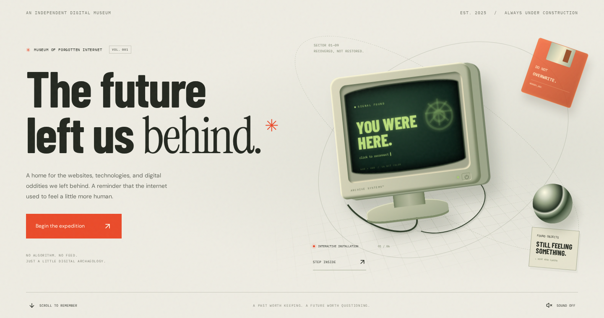

</div>

---

## Tentang proyek

**The Lost Archive** bukan sekadar katalog nostalgia. Pengunjung diajak menjelajah sebuah museum eksperimental: membangunkan monitor CRT, bermain dengan desktop internet lawas, membuka artefak, dan meninggalkan cahaya untuk layanan digital yang telah tutup.

Arah visualnya memadukan **retro-futurism**, tipografi archival, tekstur kertas, objek CSS berperspektif, dan grid editorial. Palet kertas hangat, hijau gelap, acid green, serta vermilion menjaga suasana antara arsip fisik dan dunia digital.

> **Frontend-only:** tidak memerlukan backend, database, API key, atau environment variable untuk dijalankan.

## Daftar isi

- [Fitur utama](#-fitur-utama)
- [Galeri aplikasi](#-galeri-aplikasi)
- [Teknologi](#-teknologi)
- [Menjalankan proyek](#-menjalankan-proyek)
- [Struktur proyek](#-struktur-proyek)
- [Panduan interaksi](#-panduan-interaksi)
- [Penyimpanan dan batasan](#-penyimpanan-dan-batasan)
- [Pengecekan dan screenshot](#-pengecekan-dan-screenshot)
- [Deploy ke Vercel](#-deploy-ke-vercel)
- [Pengembangan lanjutan](#-pengembangan-lanjutan)

## ✦ Fitur utama

| Ruang / fitur | Pengalaman |
| :--- | :--- |
| **Interactive CRT Installation** | Monitor bergaya CRT dengan scanline, gerak melayang, perspektif mengikuti kursor, dan layar yang berubah ketika diklik. |
| **Memory Machine** | Desktop retro dengan enam aplikasi, taskbar, serta jendela yang dapat dibuka, ditutup, dipindahkan, dan dibawa ke depan. |
| **The Old Web** | Simulasi homepage personal dengan navigasi ke artefak dan guestbook. |
| **Visual Music Player** | Visualizer animasi dengan kontrol play/pause; bukan pemutar file audio. |
| **Dear Future Me** | Editor surat dengan fungsi simpan dan pulihkan menggunakan `localStorage`. |
| **Guestbook** | Pesan pengunjung untuk sesi kunjungan saat ini, tanpa pengiriman ke server. |
| **The Collection** | Enam artefak kurasi dengan filter kategori, pencarian, penemuan acak, dan tampilan grid/kabinet. |
| **Artifact Detail** | Dialog detail berisi cerita, fakta ringkas, tautan sumber, dan navigasi ke objek berikutnya. |
| **Digital Afterlife** | Galeri memorial horizontal yang mengikuti scroll, dengan cahaya memorial yang dapat dinyalakan. |
| **Internet Timeline** | Lima bab sejarah internet yang dapat dipilih, dari 1989 hingga 2017. |
| **Secret Terminal** | Terminal dengan command navigasi, penemuan artefak acak, dan shortcut `Ctrl/Cmd + K`. |
| **Responsive Layout** | Tampilan desktop dan mobile, menu navigasi mobile, serta penyesuaian untuk preferensi reduced motion. |

## ✦ Galeri aplikasi

Semua gambar berikut adalah **screenshot aplikasi yang berjalan**, bukan mockup. Berkas disimpan di [`docs/screenshots/`](docs/screenshots/) menggunakan path relatif agar tetap tampil di GitHub.

### 01 — Memory Machine

Desktop lawas sebagai ruang pamer yang bisa dimainkan. Klik ikon untuk membuka aplikasi; geser jendela untuk mengatur ruang kerja.

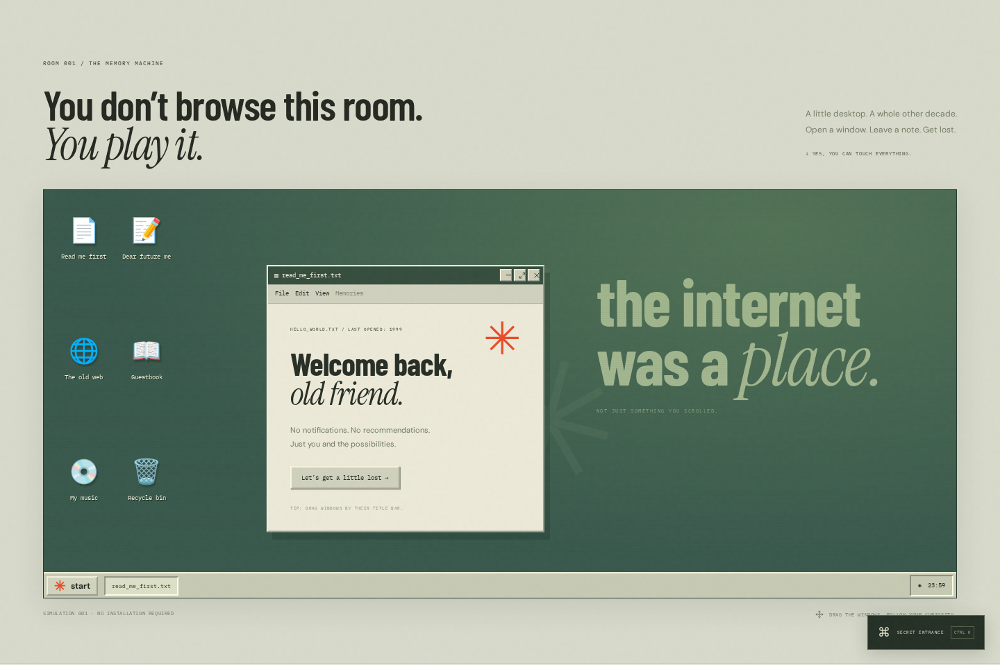

<details>
<summary><strong>Lihat semua aplikasi desktop — 5 screenshot</strong></summary>

#### The Old Web
Homepage bergaya internet personal, lengkap dengan guestbook dan pintu masuk ke koleksi.

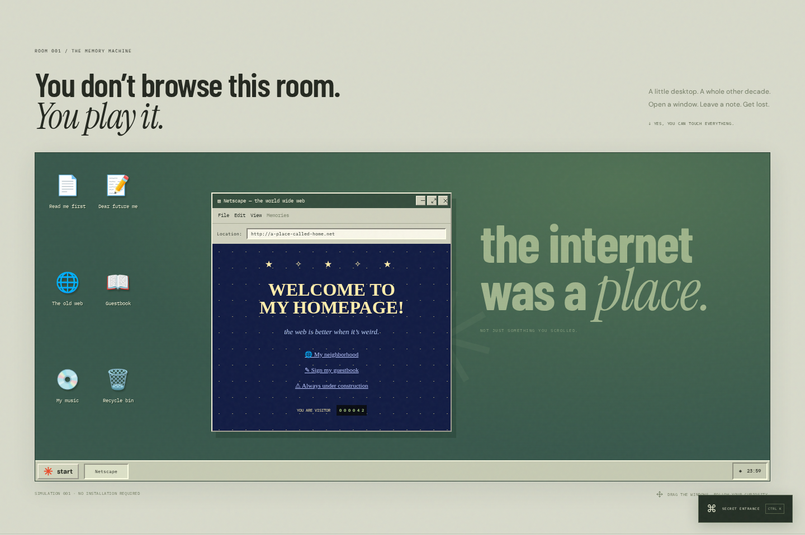

#### Visual Music Player
Visualizer yang bergerak ketika kontrol play diaktifkan. Aplikasi ini tidak melakukan streaming audio.

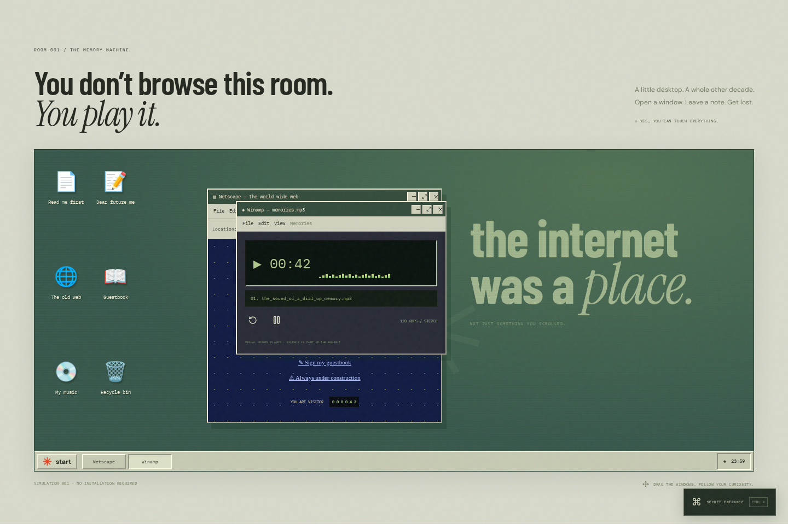

#### Dear Future Me
Surat yang dapat diedit, disimpan, dan dipulihkan pada browser/perangkat yang sama.

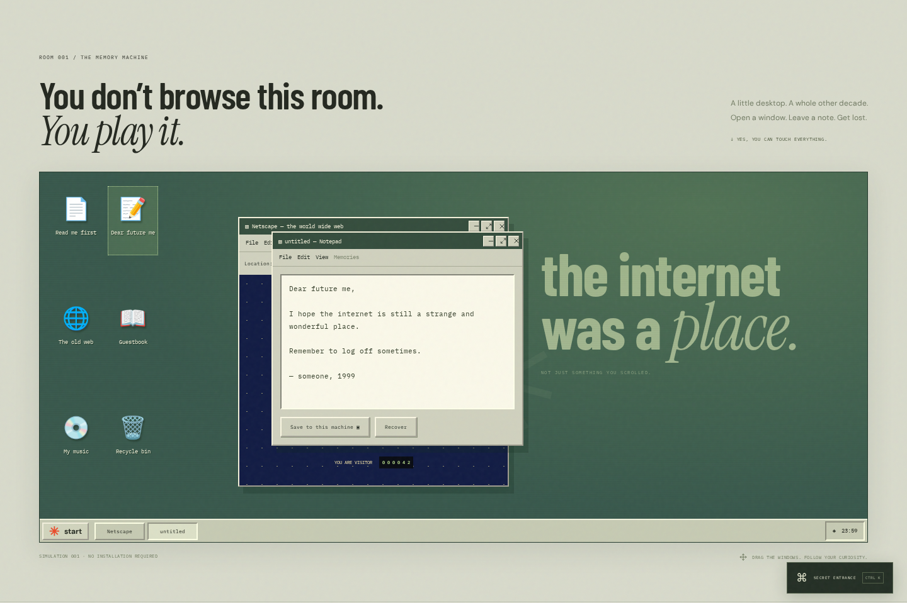

#### Guestbook
Sebuah jejak kecil dari pengunjung. Pesan pada screenshot adalah data demo untuk dokumentasi.

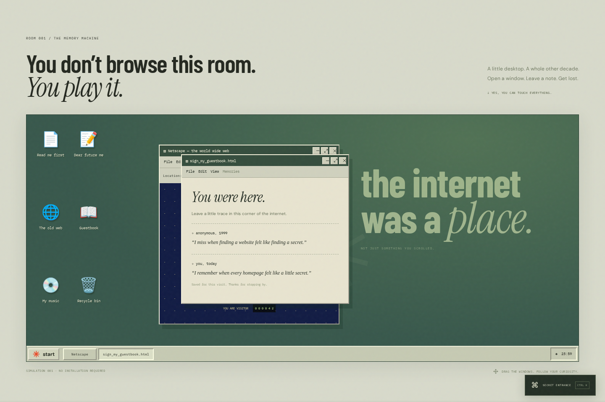

#### Recycle Bin
Objek yang seolah hilang menjadi jalan untuk menemukan kembali sebuah artefak.

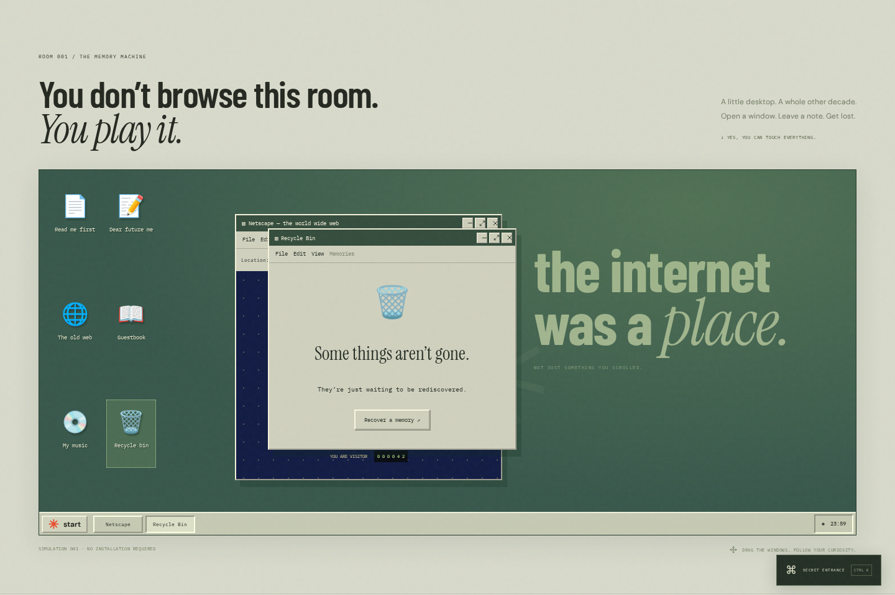

</details>

### 02 — The Collection

Koleksi website, software, hardware, dan budaya digital dalam grid editorial.

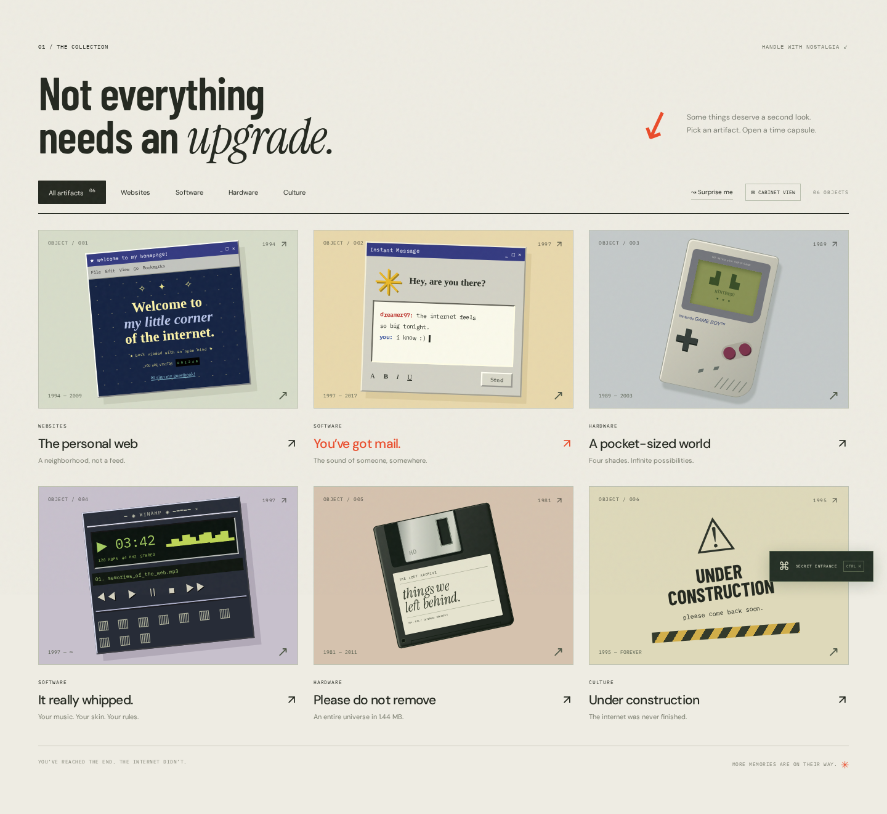

<details>
<summary><strong>Lihat Cabinet View dan detail artefak</strong></summary>

#### Cabinet View
Mode kabinet dengan komposisi kartu menyerupai objek arsip fisik.

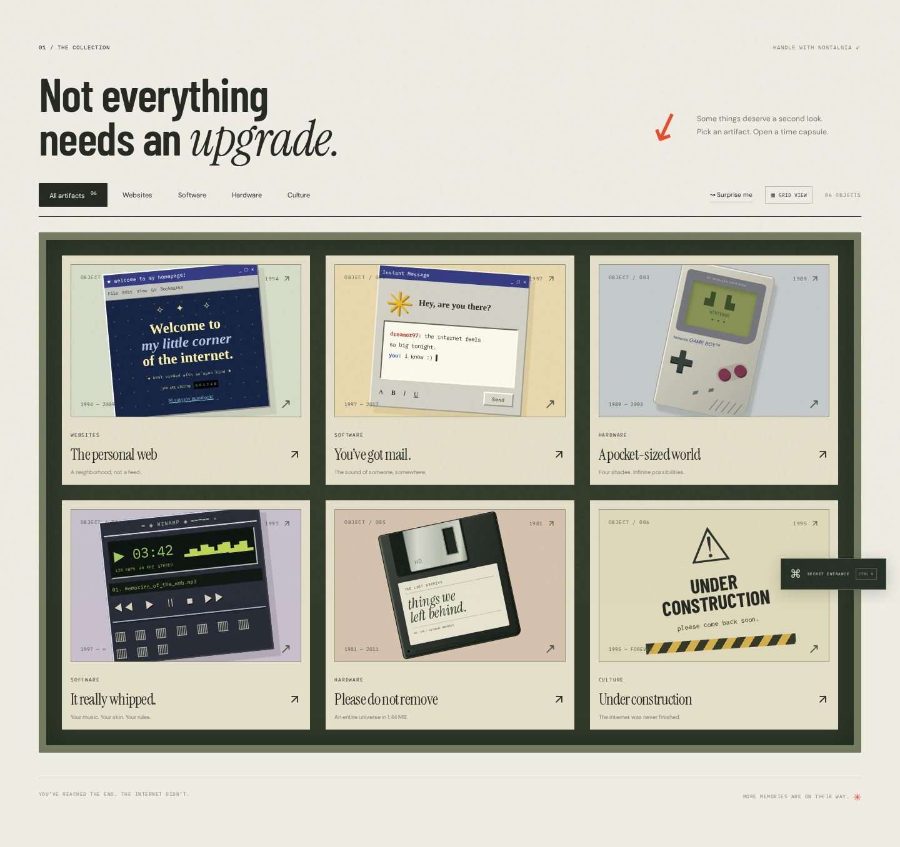

#### Detail artefak
Cerita, konteks sejarah, fakta ringkas, dan tautan untuk melanjutkan eksplorasi.

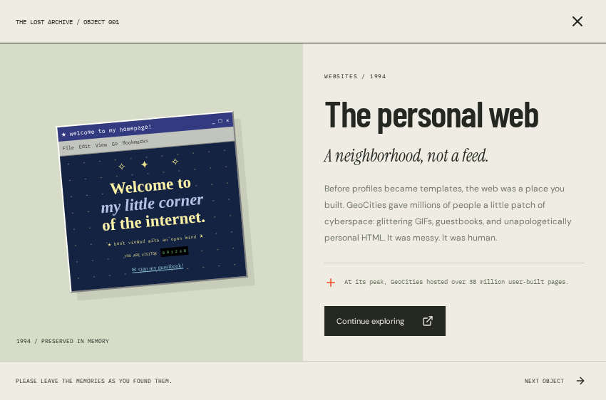

</details>

### 03 — Digital Afterlife

Sebuah ruang memorial untuk GeoCities, AIM, Flash, Google Reader, dan Vine. Scroll untuk berpindah; klik untuk meninggalkan cahaya.

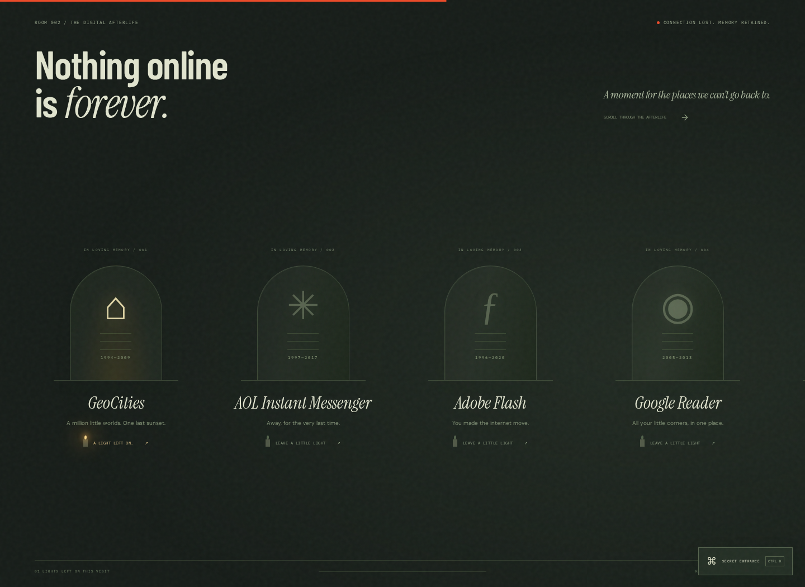

### 04 — Internet Timeline

Lima bab singkat tentang perjalanan menjadi manusia yang terhubung ke internet.

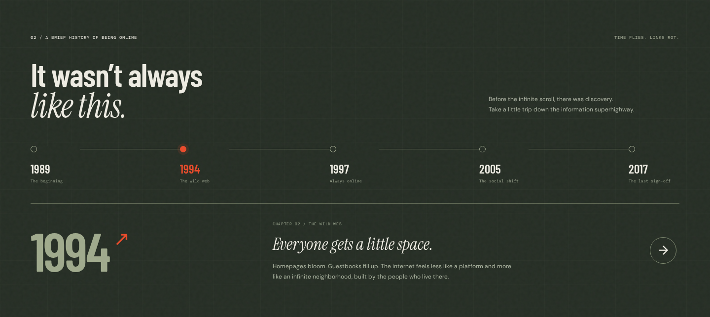

<details>
<summary><strong>Lihat catatan archivist dan terminal rahasia</strong></summary>

#### A Note from the Archivist
Pernyataan kuratorial di balik koleksi.

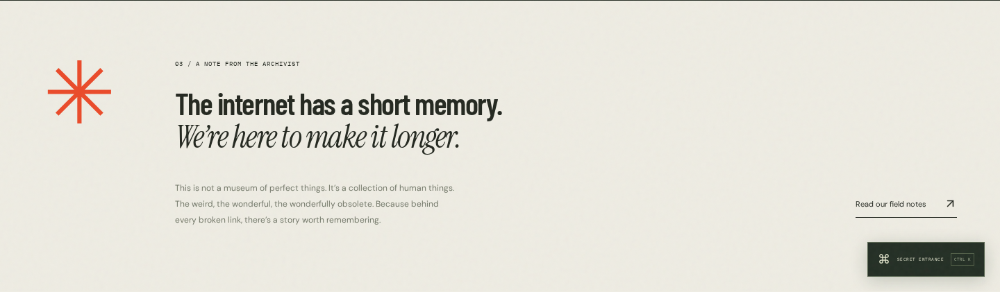

#### Secret Terminal
Buka dengan `Ctrl + K` / `Cmd + K`, atau tombol **Secret Entrance**.

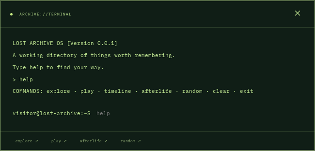

</details>

### 05 — Mobile Experience

Screenshot pada viewport **390 × 844 CSS px**. Beberapa gambar menangkap seluruh tinggi bagian, sehingga lebih panjang daripada satu layar.

<table>
  <tr>
    <td align="center" width="50%"><strong>Hero & CRT Installation</strong></td>
    <td align="center" width="50%"><strong>Memory Machine</strong></td>
  </tr>
  <tr>
    <td valign="top">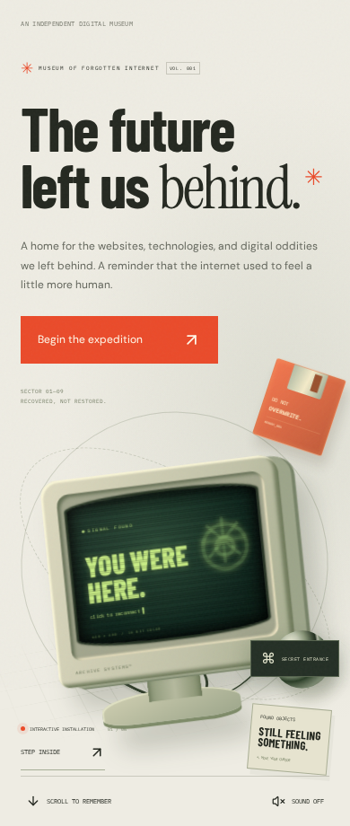</td>
    <td valign="top">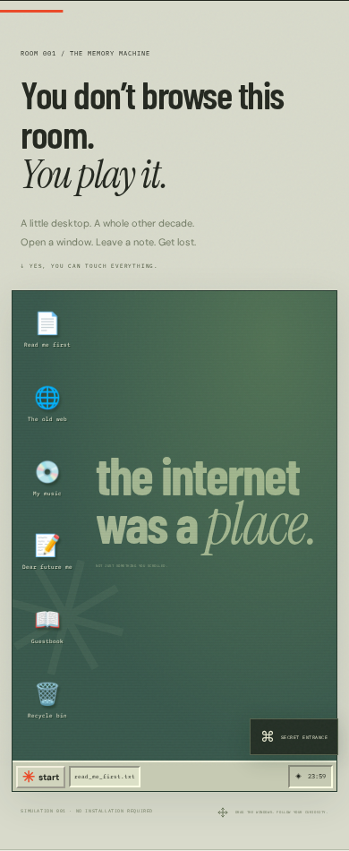</td>
  </tr>
</table>

<details>
<summary><strong>Lihat koleksi dan timeline pada mobile</strong></summary>

<table>
  <tr>
    <td align="center" width="50%"><strong>Collection</strong></td>
    <td align="center" width="50%"><strong>Timeline</strong></td>
  </tr>
  <tr>
    <td valign="top">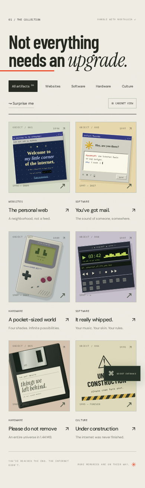</td>
    <td valign="top">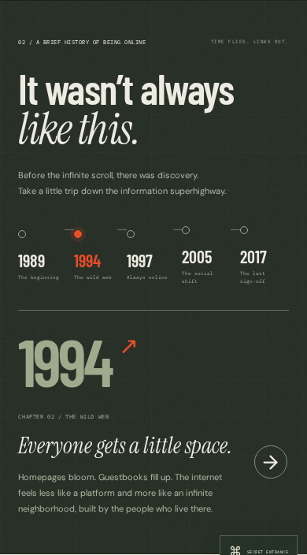</td>
  </tr>
</table>

</details>

## ✦ Teknologi

| Teknologi | Peran |
| :--- | :--- |
| **React 19** | Komponen UI dan state interaksi. |
| **Vite 7** | Development server dan production bundling. |
| **Framer Motion 12** | Animasi masuk/keluar, draggable windows, layout animation, dan scroll-linked motion. |
| **Lucide React** | Ikon antarmuka. |
| **CSS** | Tekstur, ilustrasi artefak, objek CRT berperspektif, grid, dan responsive styling. |
| **Playwright** | Smoke check browser dan pengambilan screenshot dokumentasi. |

Font: **Barlow Condensed**, **DM Sans**, **IBM Plex Mono**, dan **Instrument Serif** melalui Google Fonts, dengan font sistem sebagai fallback.

## ✦ Menjalankan proyek

### Prasyarat

- **Node.js 20.19+** atau **22.12+**; Node.js 22 LTS direkomendasikan.
- npm.

### Instalasi

```bash
git clone https://github.com/rilians/the-lost-archive.git
cd the-lost-archive
npm ci
npm run dev
```

Buka alamat yang dicetak Vite di terminal; default-nya `http://localhost:5173`. Apabila port dipakai, Vite memilih port berikutnya.

### Perintah

| Perintah | Fungsi |
| :--- | :--- |
| `npm run dev` | Menjalankan development server. |
| `npm run build` | Menghasilkan production build di `dist/`. |
| `npm run preview` | Menjalankan preview build production. |
| `npm run check:browser` | Menjalankan smoke check terhadap server yang aktif. |
| `npm run screenshots` | Mengambil ulang 18 screenshot dokumentasi. |

Tidak ada environment variable wajib. `BASE_URL` hanya digunakan oleh script pemeriksaan/screenshot bila server berjalan pada alamat selain default.

## ✦ Struktur proyek

```text
the-lost-archive/
├── checks/
│   ├── check.mjs             # Smoke check alur utama desktop dan mobile
│   └── screenshots.mjs       # Generator 18 screenshot dokumentasi
├── docs/
│   └── screenshots/          # Screenshot asli yang ditampilkan di README
├── src/
│   ├── main.jsx              # Koleksi, filter, pencarian, modal, timeline, halaman utama
│   ├── Experience.jsx        # CRT, Memory Machine, Digital Afterlife, terminal
│   ├── style.css             # Sistem visual dan layout dasar
│   └── experience.css        # Styling ruang pamer interaktif
├── .gitignore
├── index.html
├── package.json
├── package-lock.json
├── vercel.json
├── vite.config.js
└── README.md
```

## ✦ Panduan interaksi

### Rute eksplorasi yang disarankan

1. **Klik monitor CRT** untuk membangunkan layar.
2. Buka **Memory Machine** dan pilih ikon aplikasi.
3. **Geser title bar** untuk memindahkan jendela. Tombol tutup menghapus jendela dari desktop; ikon aplikasi membukanya kembali.
4. Coba tulis surat, tekan **Save to this machine**, lalu **Recover** untuk memulihkan surat tersimpan.
5. Jelajahi **Collection**: gunakan kategori, ikon pencarian di header, **Surprise me**, atau **Cabinet View**.
6. Buka objek untuk membaca detail; lanjutkan dengan **Next Object**.
7. Scroll melewati **Digital Afterlife** dan tinggalkan cahaya pada memorial.
8. Pilih tahun di **Internet Timeline** untuk mengganti bab cerita.

### Terminal

| Command | Aksi |
| :--- | :--- |
| `help` | Menampilkan command yang tersedia. |
| `explore` | Menuju koleksi. |
| `play` | Menuju Memory Machine. |
| `timeline` | Menuju timeline internet. |
| `afterlife` | Menuju Digital Afterlife. |
| `random` | Membuka detail artefak acak. |
| `clear` | Menghapus output terminal. |
| `exit` | Menutup terminal. |

Gunakan **Escape** untuk menutup terminal atau dialog artefak. Tombol command di terminal dapat diklik untuk mengisi input; tekan Enter untuk menjalankannya.

## ✦ Penyimpanan dan batasan

| Data / fungsi | Perilaku saat ini |
| :--- | :--- |
| Surat pribadi | Disimpan lokal di browser dengan key `lost-archive-letter`. Tidak diunggah ke server. Pemulihan dilakukan melalui tombol **Recover**. |
| Guestbook | State React untuk kunjungan saat ini; hilang setelah refresh. Bukan guestbook publik bersama. |
| Cahaya memorial | State kunjungan saat ini; hilang setelah refresh. |
| Koleksi | Data statis dalam `src/main.jsx`. |
| Music player | Simulasi visual. Play/pause mengendalikan visualizer, bukan audio. |
| Tombol sound pada hero | Menghasilkan nada singkat menggunakan Web Audio ketika diaktifkan; bukan soundtrack berulang. |
| Kontrol jendela retro | Tutup/minimize menyembunyikan jendela; maximize menampilkan pesan, bukan mode fullscreen. |
| Sumber eksternal | Tautan sumber membuka situs eksternal. Font Google memerlukan koneksi internet. |

**Aksesibilitas dasar:** elemen interaktif menggunakan button/link, sejumlah kontrol ikon memiliki label, focus outline tersedia, dialog memiliki atribut ARIA, dan CSS menyertakan aturan reduced motion. Proyek belum menjalani audit aksesibilitas menyeluruh; focus trap dialog dan pengujian screen reader merupakan pengembangan lanjutan.

Ilustrasi artefak merupakan interpretasi CSS, bukan screenshot produk asli. Nama produk dan merek adalah milik pemilik masing-masing. Narasi sejarah adalah ringkasan kuratorial; gunakan tautan pada detail artefak untuk penelusuran lebih lanjut.

## ✦ Pengecekan dan screenshot

Jalankan aplikasi pada terminal pertama:

```bash
npm run dev
```

Siapkan browser pengujian pada terminal kedua:

```bash
npx playwright install chromium
# Pada Linux, bila library sistem Chromium belum tersedia:
npx playwright install-deps chromium
```

Kemudian:

```bash
npm run check:browser
npm run screenshots
```

Jika development server berjalan di port lain:

```bash
BASE_URL=http://localhost:5174 npm run check:browser
BASE_URL=http://localhost:5174 npm run screenshots
```

> Sintaks environment variable di atas untuk shell Unix/macOS/Linux. Pada PowerShell gunakan `$env:BASE_URL="http://localhost:5174"` sebelum menjalankan perintah npm.

Smoke check mencakup interaksi CRT, pembukaan browser retro, filter hardware, dialog artefak, terminal, error JavaScript, dan pemeriksaan overflow horizontal mobile. Script screenshot menangkap **18 tampilan**, termasuk seluruh enam aplikasi Memory Machine, grid/kabinet, dialog, memorial, timeline, terminal, dan mobile.

Pengujian ini adalah smoke check, bukan pengganti unit test, audit aksesibilitas, atau pengujian lintas browser yang lengkap.

## ✦ Deploy ke Vercel

### Melalui integrasi GitHub

1. Push kode ke repositori GitHub.
2. Di Vercel pilih **Add New → Project**, lalu import repositori ini.
3. Gunakan pengaturan berikut:

| Pengaturan | Nilai |
| :--- | :--- |
| Framework Preset | `Vite` |
| Root Directory | Root repositori (`./`) |
| Install Command | `npm ci` |
| Build Command | `npm run build` |
| Output Directory | `dist` |
| Environment Variables | Tidak diperlukan |

4. Klik **Deploy**. Jika integrasi Git aktif, push selanjutnya akan memicu deployment otomatis.

### Melalui CLI

```bash
npx vercel
# Setelah meninjau preview:
npx vercel --prod
```

`vercel.json` menyertakan konfigurasi build dan fallback SPA. Folder `docs/screenshots` adalah dokumentasi repositori dan tidak disalin ke hasil build aplikasi oleh Vite.

## ✦ Pengembangan lanjutan

- [ ] Memisahkan data artefak ke modul data atau CMS.
- [ ] Menambahkan persistence backend untuk guestbook dengan moderasi.
- [ ] Menambahkan focus trap dialog dan navigasi keyboard lengkap pada desktop.
- [ ] Memperluas pengujian browser, unit test, serta audit aksesibilitas.
- [ ] Mengimplementasikan fullscreen/minimize jendela yang lebih menyerupai OS.
- [ ] Menambahkan audio berlisensi dan kontrol audio yang lebih lengkap.
- [ ] Menyimpan font secara lokal untuk pengalaman tanpa ketergantungan Google Fonts.

### Kontribusi dan lisensi

Ide, laporan bug, dan usulan perbaikan dapat diajukan melalui Issues atau Pull Request. Hindari menyertakan token, kredensial, atau data pribadi.

Repositori ini **belum menyertakan lisensi open-source**. Visibilitas publik tidak otomatis memberikan izin penggunaan ulang; pemilik proyek dapat menambahkan lisensi yang sesuai.

---

<div align="center">

**NO ALGORITHM. NO FEED. JUST A LITTLE DIGITAL ARCHAEOLOGY.**

*Made for humans, not algorithms.*

</div>
